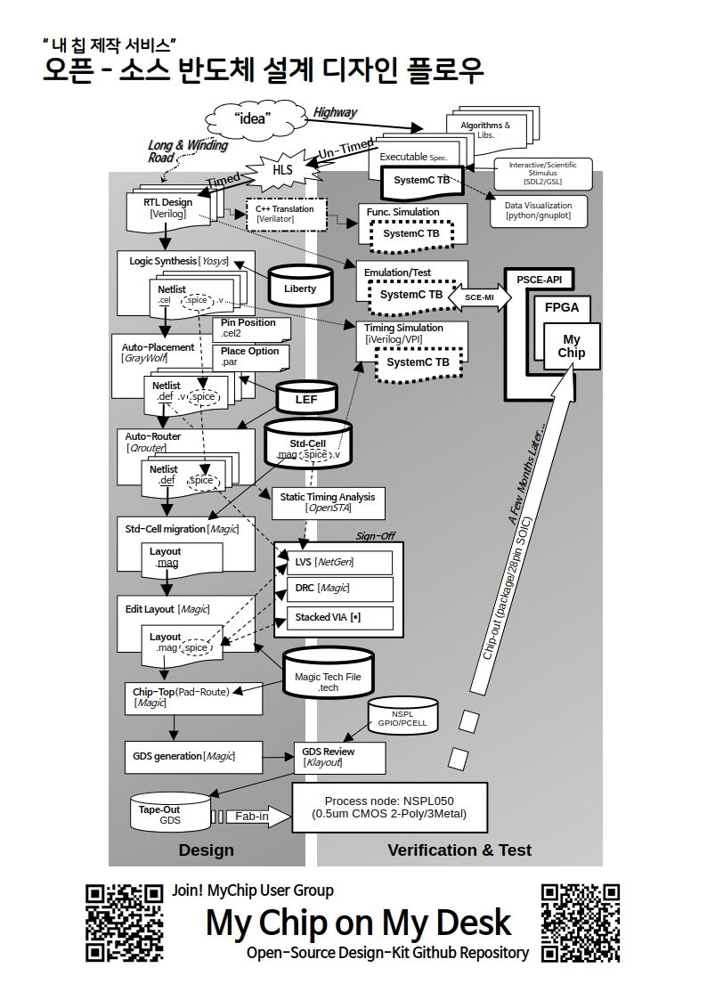
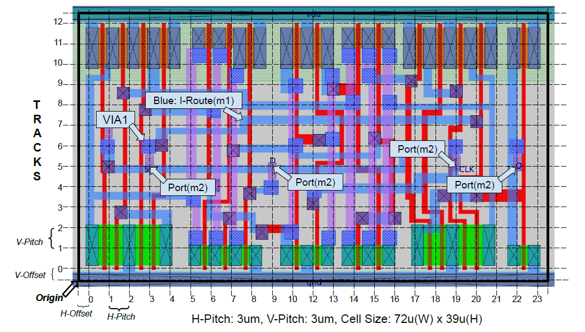
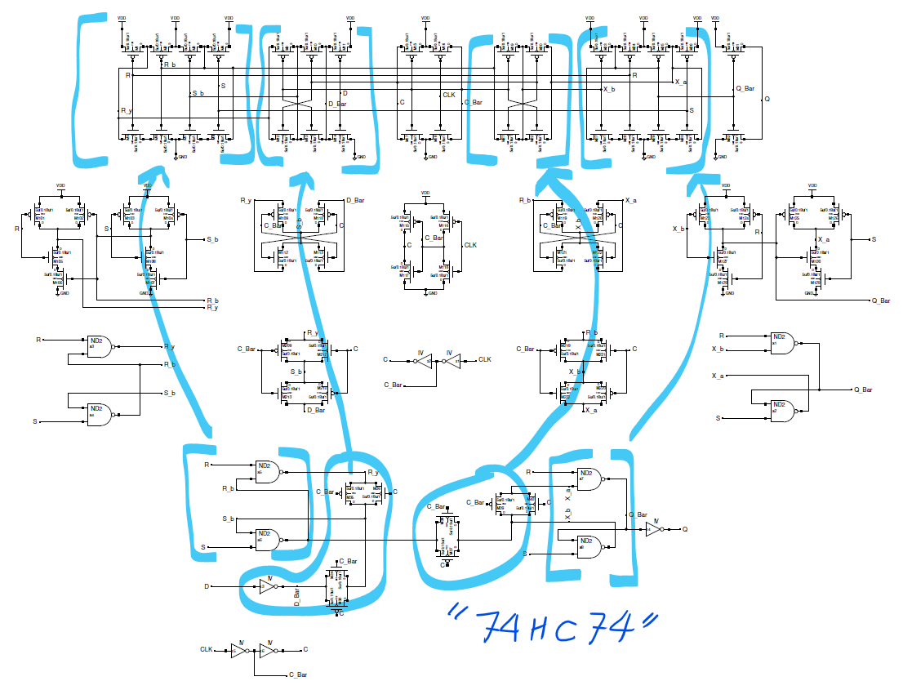

# ETRI 0.5um CMOS MPW Std-Cell Design Kit

This repository contains standard-cell libraries, technology files, tool-installation
scripts, and teaching examples for the ETRI 0.5 µm CMOS multi-project wafer (MPW)
flow. It covers circuit simulation, RTL simulation, synthesis, placement and routing,
layout verification, GDS export, FPGA emulation, and chip testing.

Start with the [repository layout](#repository-layout), follow the
[setup instructions](#setup), then try the [FIR processing-element example](#rtl-to-layout-example-fir_pe).
For circuit-level work, start with the inverter tutorials listed below.



## Repository layout

Paths in this table are relative to the repository root.

| Path | Contents and purpose |
| --- | --- |
| [`tech/`](tech/) | Magic technology files, QFlow's `etri050` configuration, Netgen setup, device models, KLayout layer display settings, and DRC scripts. |
| [`digital_ETRI/`](digital_ETRI/) | Active standard-cell library used by the example flows: Magic layouts, LEF, Liberty timing data, Verilog models, SPICE, and GDSII. Cell-configuration targets update this shared directory. |
| [`digital_ETRI050_m1f/`](digital_ETRI050_m1f/), [`digital_ETRI050_m2f/`](digital_ETRI050_m2f/) | Alternative cell-layout sets selected with `make config_m1f` or `make config_m2f` in the FIR_PE example. |
| [`digital_osu050/`](digital_osu050/) | OSU 0.5 µm reference-cell data, including the SPICE reference used by the ETRI library's comparison target. |
| [`analog_ETRI/`](analog_ETRI/), [`pads_ETRI/`](pads_ETRI/) | Analog and I/O-pad libraries, including GDS and Magic views for chip assembly. |
| [`sch/`](sch/), [`spice/`](spice/) | Xschem schematics, SPICE models, cell netlists, and circuit testbenches. |
| [`irsim/`](irsim/), [`lvs/`](lvs/) | Switch-level simulation examples and cell-level layout-versus-schematic (LVS) comparison inputs/results. |
| [`Tools/`](Tools/) | Dependency and tool build/install scripts, shell environment snippets, vendor-tool notes, and bundled installation inputs. Downloaded tool source/build trees may also appear here locally. |
| [`scripts/`](scripts/) | Shared extraction, DRC, LVS, via-stack checking, layout conversion, and chip-generation utilities; RTL/HLS project templates. |
| [`Tutorials/`](Tutorials/) | Circuit, RTL, SystemC, HLS, emulation, physical-design, and chip-test labs. The worked commands in this README use this tree. |
| [`Tutorials_New/`](Tutorials_New/) | A separately organized tutorial tree with FIR8, FIR_PE, emulation, chip-test, and HLS examples. Paths and dependencies differ from `Tutorials/`; follow each example's Makefiles. |
| [`Projects/`](Projects/) | Larger RTL, SystemC, HLS, neural-network, game, and test-kit projects. |
| [`PSCE_API/`](PSCE_API/) | Arduino APIs, wrappers, board schematics/PCB files, and an example DUT for the co-emulation/test interface. |
| [`docs/`](docs/) | Process references, standard-cell guides, lectures, design-flow documents, and environment notes. |

The main library views in `digital_ETRI/` are:

| File | Use |
| --- | --- |
| `*.mag`, `khu_etri050_stdcells.mag` | Individual cells and the library assembly in Magic. |
| `etri050_stdcells.lef` | Cell geometry and pins for placement/routing. |
| `khu_etri05_stdcells.lib` | Liberty cell functions and timing for synthesis/timing analysis. |
| `khu_etri05_stdcells_func.v` | Functional cell models for gate-level simulation. |
| `khu_etri05_stdcells.v` | Cell models used by the timing-simulation example. |
| `khu_etri050_stdcells.spice` | Transistor-level cell netlists for comparison/extraction flows. |
| `khu_etri050_stdcells.gds2` | GDSII cell layouts. |

## Setup

### 1. Establish the expected checkout path

Many Makefiles, Magic startup files, and scripts refer directly to
`~/ETRI050_DesignKit`. Create that link **before installing QFlow**, whose installer
links its technology directory to this checkout. From the repository root:

```sh
# Run only if ~/ETRI050_DesignKit does not already exist.
ln -s "$(pwd -P)" "$HOME/ETRI050_DesignKit"
cd "$HOME/ETRI050_DesignKit"
```

If the path already exists, check that it points to the intended checkout. The
absolute link target keeps the link valid regardless of the checkout's parent
directory. To use a different location without this link, adjust the hard-coded
paths in the relevant scripts, Makefiles, and `.magicrc` files as well as the shell
environment.

### 2. Install the tools needed for your workflow

The supplied installers target an Ubuntu/Debian-style Linux environment: they use
`apt`, source builds, and `sudo`. Downloads need network access; graphical tools
such as Magic, Xschem, KLayout, and GTKWave need a working display.

Review [`Tools/prerequisites.sh`](Tools/prerequisites.sh) before running it: it
includes system upgrade and autoremove commands as well as package installation.
Run the scripts from `Tools/`, because they use relative paths:

```sh
cd "$HOME/ETRI050_DesignKit/Tools"
./prerequisites.sh
./build_tools.sh
```

[`build_tools.sh`](Tools/build_tools.sh) invokes the individual installers. To
install or rebuild selected tools, use the corresponding scripts:

| Workflow | Tools and installer scripts in `Tools/` |
| --- | --- |
| RTL to layout | Yosys (`yosys_build.sh`), GrayWolf (`graywolf_build.sh`), QRouter (`qrouter_build.sh`), Magic (`magic_build.sh`), Netgen (`netgen_build.sh`), and ETRI-enabled QFlow (`qflow-1.4.100_etri050_build.sh`). |
| Timing and layout inspection | OpenSTA (`opensta_build.sh`), KLayout (`klayout_install.sh`). |
| Circuit and switch-level simulation | ngspice (`ngspice_build.sh`), Xschem (`xschem_build.sh`), IRSIM (`irsim_build.sh`). |
| RTL/SystemC simulation | Icarus Verilog (`iverilog_build.sh`), SystemC (`systemc_build.sh`), Verilator (`verilator_build.sh`), GTKWave (`gtkwave_install.sh`). FIR testbenches also use GSL (`gsl_build.sh`). |

Use the bundled ETRI QFlow installer for the documented physical-design example.
It installs QFlow and creates technology/library links under
`/usr/local/share/qflow/tech/etri050`; it also replaces an existing installation's
`etri050.bak` directory. Build scripts pull upstream sources or download specific
packages, so inspect their output and adjust package versions or build options for
your machine when needed.

Vitis HLS, Vivado, Quartus/Altera, Gowin, and Arduino-based examples need their
respective additional toolchains and, for emulation/chip tests, the matching
hardware. `Tools/` contains related environment files and notes; these vendor
toolchains are separate from the basic open-source installation.

### 3. Configure the shell and SystemC paths

Load the design-kit paths into each shell used for the examples:

```sh
source "$HOME/ETRI050_DesignKit/Tools/DK_env"
```

This sets `DK_HOME`, `DK_STD_CELL`, `DK_ANA_LIB`, `DK_TECH`, and `DK_SCRIPT`, and adds
the shared scripts to `PATH`. The pad-library path used by layout flows is
`$DK_HOME/pads_ETRI`.

Inspect [`Tools/SC_env`](Tools/SC_env), [`Tools/CAD_env`](Tools/CAD_env), and the
chosen example's Makefile before running SystemC simulation. `SC_env` and many
example Makefiles use `/opt/systemc` with libraries under `lib`, while `CAD_env`
uses `/usr/local/systemc-3.0.0` with `lib-linux64`. The SystemC build script runs
CMake without an explicit installation prefix. Set these paths to the actual
installation; sourcing an environment file alone does not override assignments
inside a Makefile.

```sh
# Edit SC_env first if SystemC is installed elsewhere.
source "$HOME/ETRI050_DesignKit/Tools/SC_env"
```

Check that the physical-design commands are on `PATH` and that QFlow's technology
links point to this checkout:

```sh
command -v yosys graywolf qrouter magic netgen qflow
ls -l /usr/local/share/qflow/tech/etri050
```

## Choose a starting example

| Goal | Starting point |
| --- | --- |
| Learn schematic entry, layout, and LVS | [`Tutorials/1-1_Inverter_XSchem/`](Tutorials/1-1_Inverter_XSchem/), [`1-2_Inverter_Magic/`](Tutorials/1-2_Inverter_Magic/), [`1-3_Inverter_Netgen/`](Tutorials/1-3_Inverter_Netgen/), then [`1-4_StdCell_DFFSR/`](Tutorials/1-4_StdCell_DFFSR/). |
| Learn Verilog and SystemC | [`Tutorials/2-2_Verilog_SystemC_in_a_Day/`](Tutorials/2-2_Verilog_SystemC_in_a_Day/), [`2-3_Lab1_dff/`](Tutorials/2-3_Lab1_dff/), and [`2-4_Lab2_Shifter/`](Tutorials/2-4_Lab2_Shifter/). |
| Compare C++, SystemC, and RTL FIR models | [`Tutorials/2-5_Lab3_FIR8/`](Tutorials/2-5_Lab3_FIR8/). |
| Run RTL through physical design | [`Tutorials/2-7_Lab5_FIR8_rtl_ETRI050/`](Tutorials/2-7_Lab5_FIR8_rtl_ETRI050/) or the FIR_PE walkthrough below. |
| Explore FPGA emulation and chip testing | [`Tutorials/2-10_Lab8_FIR_PE_Emulation/`](Tutorials/2-10_Lab8_FIR_PE_Emulation/), [`2-12_Lab8_FIR_PE_Chip_Test/`](Tutorials/2-12_Lab8_FIR_PE_Chip_Test/), and [`PSCE_API/`](PSCE_API/). |
| Explore high-level synthesis | [`Tutorials/2-11_Lab9_FIR_PE_Vitis-HLS/`](Tutorials/2-11_Lab9_FIR_PE_Vitis-HLS/) and the `Tutorials/7-*` labs. |

In Makefile-based examples, running `make` usually prints the available targets.
Read the local Makefile for required variables and paths. Some examples reuse
sources from neighboring labs, so preserve their relative directory structure.

For a small C++/GSL check before setting up the full physical flow:

```sh
cd "$HOME/ETRI050_DesignKit/Tutorials/2-5_Lab3_FIR8/c_untimed"
make build HW_STYLE=MACC
make run
```

This produces the `fir8_tb` executable and `fir8_tb_out.txt` sample output.

## RTL-to-layout example: FIR_PE

[`Tutorials/2-9_Lab7_FIR_PE/`](Tutorials/2-9_Lab7_FIR_PE/) implements a FIR
processing element. Its main directories are:

```text
source/       RTL input (fir_pe.v)
simulation/   Verilator/SystemC and Icarus Verilog testbenches
synthesis/    Generated synthesis netlists
layout/       Placement inputs, generated layouts, verification, and GDS export
log/          QFlow stage logs
chip_top/     Chip-level assembly layouts and a separate Makefile
irsim/        Switch-level simulation inputs
```

### 1. Select the shared cell library

After tool installation, choose one cell set:

```sh
cd "$HOME/ETRI050_DesignKit/Tutorials/2-9_Lab7_FIR_PE"
make config_m1f
# Alternative: make config_m2f
```

These targets copy layouts from the selected variant into `digital_ETRI/` and run
its Makefile to regenerate library views as needed. They modify the shared library
used by other projects and can change tracked files. Keep the selected library
consistent throughout synthesis, routing, extraction, and verification; rerun the
flow when changing variants.

### 2. Simulate the RTL

With Verilator, SystemC, GSL, GTKWave, and the plotting dependencies configured:

```sh
cd "$HOME/ETRI050_DesignKit/Tutorials/2-9_Lab7_FIR_PE/simulation"
make lint
make build
make run
```

`make run` runs the SystemC testbench and launches plotting/waveform viewers.
The executable is `obj_dir/Vfir_pe`; it can also be run directly. Use
`make wave` to view its Verilog trace. If SystemC is outside `/opt/systemc`, pass
the correct location to the build, for example
`make build SYSTEMC=/your/systemc/prefix SYSTEMC_LIBDIR=/your/systemc/prefix/lib`.

### 3. Synthesize, place, route, and verify

Run these stages in order from the example root:

```sh
cd "$HOME/ETRI050_DesignKit/Tutorials/2-9_Lab7_FIR_PE"
make synthesize
make place
make route
make migrate
make lvs
```

The Makefile calls QFlow with `-T etri050`. Synthesis maps `source/fir_pe.v` to
the standard-cell library; placement and routing produce the physical design;
`migrate` creates the Magic layout; `lvs` compares extracted connectivity with the
synthesized circuit. `project_vars.sh` contains QFlow options (in **tcsh** syntax),
while `layout/fir_pe.par` and `layout/fir_pe.cel2` supply placement/pin settings.
The root Makefile also provides `sta` and `size` targets.

Inspect the stage logs under `log/`, including `synth.log`, `place.log`,
`route.log`, `magic_db.log`, and `lvs.log`, before continuing after a failed stage.

### 4. Check the layout and export GDSII

```sh
make -C layout stack drc lvs mag2gds
make -C layout klayout
```

The layout Makefile checks via stacks, runs design-rule checking (DRC) and LVS,
and exports `layout/fir_pe_F.mag` and `layout/fir_pe_F.gds`. Review
`fir_pe_Stacked.log`, `fir_pe_DRC.log`, `fir_pe_LVS.log`, and `LVS_fir_pe.txt` in
`layout/` for the actual results; a completed command alone does not establish
that the design passes verification. `make -C layout magic` opens the flattened
Magic layout. Chip-level pad/core assembly is handled separately in `chip_top/`.

## Adapt the kit to your own design

Use a working tutorial as the starting point. Set `TOP_MODULE` and the RTL source
list in its Makefiles, update the testbench, and adapt the placement/pin files,
QFlow options, and layout targets. Check for references to the original module
name and neighboring tutorial sources before building the copied project.

For template-based projects, inspect [`scripts/RTL_Project.sh`](scripts/RTL_Project.sh)
and [`scripts/HLS_Project.sh`](scripts/HLS_Project.sh), plus their corresponding
template directories. Both accept `<TOP_MODULE> <HW_STYLE> <MODE> <MI>` and write
`env_settings` and a `Makefile` into the current directory, so invoke them in a
dedicated project directory. Supported settings and additional targets are
described in the template Makefiles and examples.

## Generated files and Git

The root [`.gitignore`](.gitignore) excludes downloaded tool source/build trees,
installer downloads, compiler objects, Verilator `obj_dir` output, selected Vitis
HLS caches, and FIR8 installation-check results. Bundled QFlow and SDCC source
archives remain tracked as installation inputs.

In `Tutorials/2-9_Lab7_FIR_PE/`, generated QFlow/Yosys/Magic scripts, synthesis
netlists, routing outputs, extracted circuits, and verification reports are
untracked. Regenerate them with the physical-design and layout commands above.
RTL, Makefiles, `project_vars.sh`, `.magicrc`, `.par` placement parameters,
`.cel2` pin hints, directory placeholders, and manually assembled `chip_top`
layouts remain tracked.

Rebuild compiler objects and Verilator output using the local Makefiles;
regenerate Vitis caches by rerunning HLS with the retained sources/configuration.
Bundled toolchain objects without a verified rebuild recipe, exported HLS RTL,
technology libraries, and hardware test recordings remain tracked.

Ignored files can still exist locally. Avoid a repository-wide `git clean -fdX`:
ignored paths also include local workspace configuration and credentials. Review
specific generated paths before removing them to reclaim disk space.

## Documentation, community, and license

- [Design-flow overview](docs/By_GoodKook/DK_Flow_Eng.pdf) and [reference documents](docs/).
- [Author's MPW introduction](https://fun-teaching-goodkook.blogspot.com/2024/07/mpw.html).
  The blog is in Korean; machine translation may help.
- [MyChip Open-Source Design Kit User Group](https://groups.google.com/g/mychip-on-mydesk).
- Author: Kook, goodkook(at)gmail.com.
- The root [`LICENSE`](LICENSE) contains GNU GPL version 3. Consult notices in
  individual files and bundled third-party materials for their applicable terms.





